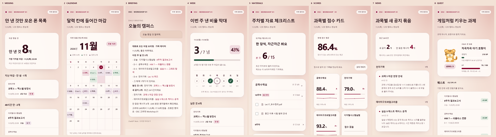
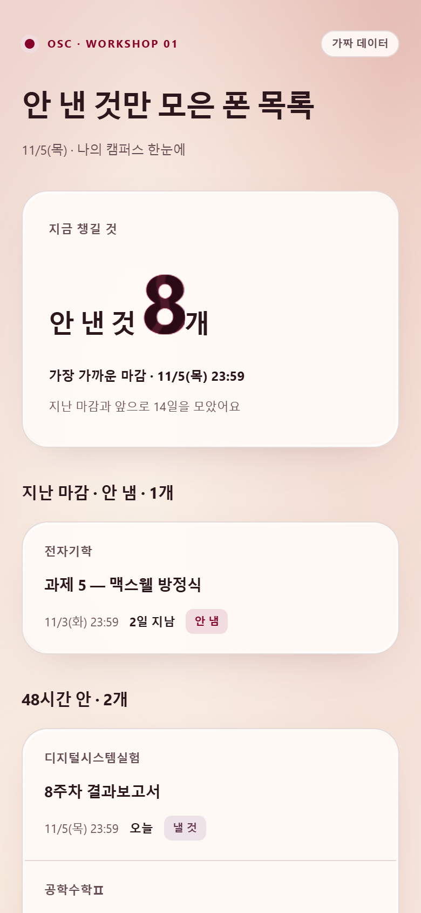
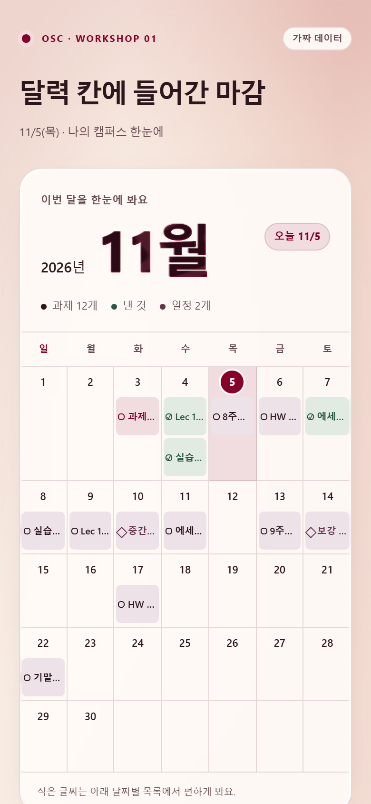
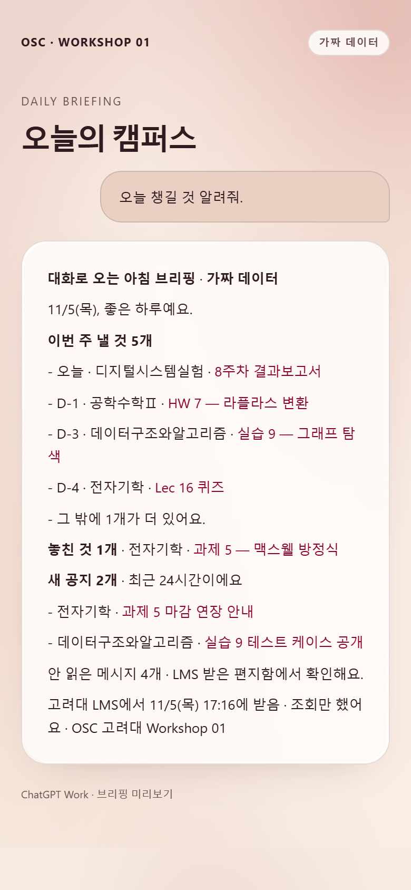
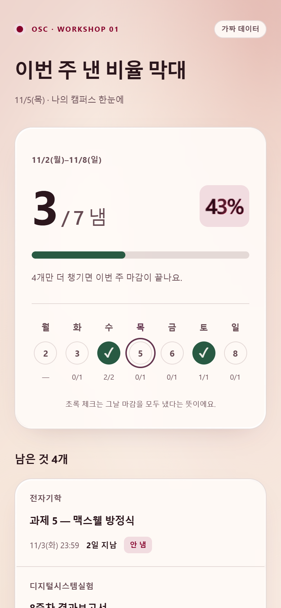
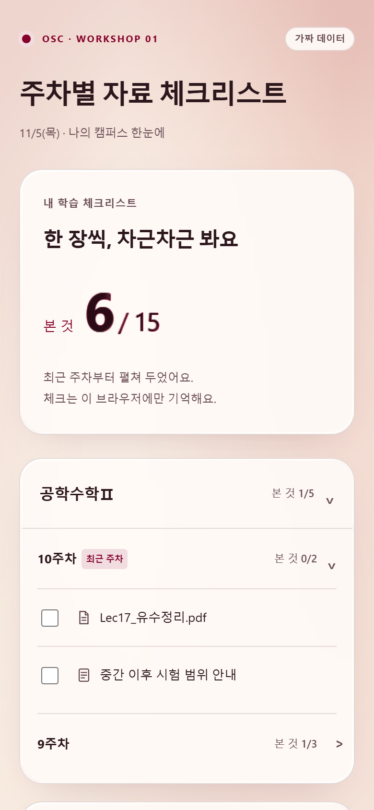
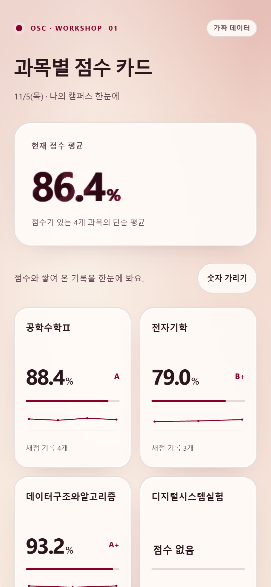
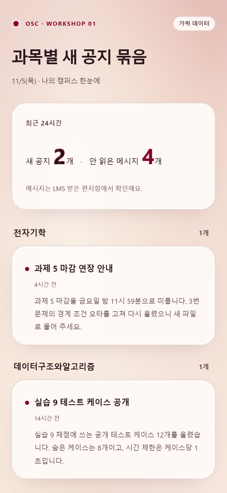
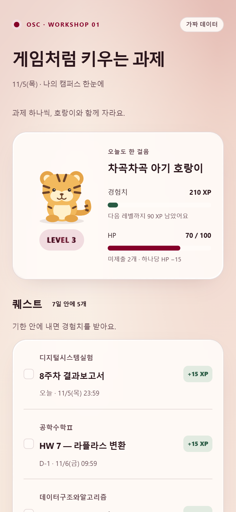

# OSC 고려대 Workshop 01 · LMS 대시보드 8가지

오늘 실습에서 ChatGPT Work에 고려대 LMS를 연결했어요.
아래 프롬프트 중 하나를 **그대로 복사해서** 같은 Work 대화에 붙이면, 내 LMS로 화면 한 장이 나와요.



## 시작 전에

| | |
|---|---|
| **어디에** | PART 02 STEP 6(API key 확인)을 했던 **그 Work 대화**에 이어서 붙여요. API key를 다시 적지 않아도 돼요. |
| **API key가 없으면** | 프롬프트의 `--ui 1`을 `--ui 1 --sample`로 바꿔요. 가짜 데이터로 같은 화면이 나와요. |
| **이 코드가 하는 일** | `mylms.korea.ac.kr`에 **조회(GET)만** 해요. 글을 쓰거나 지우는 요청은 없고, API key는 출력도 저장도 안 해요. |
| **결과** | `dashboard-1-missing.html` 같은 파일 한 개. 받아서 폰이나 PC 브라우저로 열어요. ③만 대화 메시지로 와요. |
| **코드 위치** | [`dash.py`](dash.py) 한 파일. 파이썬 기본 모듈만 써서 설치할 게 없어요. |

> 남이 준 코드를 내 API key로 돌리기 전에는, 무엇을 하는지 먼저 확인하는 습관을 들여요.
> 그래서 모든 프롬프트 첫 줄에 "조회만 하는지 먼저 확인해 줘"를 넣었어요.

## 8가지 화면

| 번호 | 화면 | 고민 | 고를 칸 | 알림 |
|---|---|---|---|---|
| [①](#ui1) | 안 낸 것만 모은 폰 목록 | 마감을 자꾸 놓쳐요 | 언제 + 했나 | 매일 아침 8시 |
| [②](#ui2) | 달력 칸에 들어간 마감 | 이번 달이 한눈에 안 보여요 | 언제 | 구글 캘린더 (BONUS) |
| [③](#ui3) | 대화로 오는 아침 브리핑 | 화면 열기도 귀찮아요 | 언제 + 했나 + 새 소식 | 매일 아침 8시 |
| [④](#ui4) | 이번 주 낸 비율 막대 | 얼마나 했는지 모르겠어요 | 했나 | 일요일 밤 9시 |
| [⑤](#ui5) | 주차별 자료 체크리스트 | 시험 자료가 흩어져 있어요 | 무엇을 | 새 자료 올라온 날 |
| [⑥](#ui6) | 과목별 점수 카드 | 성적이 어떤지 궁금해요 | 얼마나 | 새 채점 생긴 날 |
| [⑦](#ui7) | 과목별 새 공지 묶음 | 공지를 늦게 봐요 | 새 소식 | 하루 한 번 밤 9시 |
| [⑧](#ui8) | 게임처럼 키우는 과제 | 과제가 재미없어요 | 했나 | 다음 날 아침 |

---

<a id="ui1"></a>

### ① 안 낸 것만 모은 폰 목록



**Work에 붙여 넣기**
```text
나는 마감을 자꾸 놓쳐.
LMS에서 마감일과 제출 여부만 가져와서
'안 낸 것만 모은 폰 목록'으로 만들어 줘. 성적은 빼 줘.

이 코드를 받아서 그대로 써 줘.
https://raw.githubusercontent.com/Bemyvendelime/osc-ku-w1-dashboards/main/dash.py
1) 돌리기 전에 이 코드가 LMS에 조회(GET)만 하는지 먼저 확인해 줘.
2) 아까 준 API key를 CANVAS_TOKEN에 넣고 python dash.py --ui 1 로 돌려 줘.
3) 나온 html 파일을 줘.

조회(GET)만 하고, 토큰은 답에 다시 적지 마.
```
**알림도 받으려면 이어서**
```text
매일 아침 8시에 이걸 다시 돌려서,
48시간 안에 마감인데 안 낸 것만 알려 줘. 없으면 "없어요" 한 줄만.
```

<a id="ui2"></a>

### ② 달력 칸에 들어간 마감



**Work에 붙여 넣기**
```text
나는 이번 달 마감이 한눈에 안 보여.
LMS에서 마감일과 LMS 일정만 가져와서
'달력 칸에 들어간 마감'으로 만들어 줘. 공지랑 성적은 빼 줘.

이 코드를 받아서 그대로 써 줘.
https://raw.githubusercontent.com/Bemyvendelime/osc-ku-w1-dashboards/main/dash.py
1) 돌리기 전에 이 코드가 LMS에 조회(GET)만 하는지 먼저 확인해 줘.
2) 아까 준 API key를 CANVAS_TOKEN에 넣고 python dash.py --ui 2 로 돌려 줘.
3) 나온 html 파일을 줘.

조회(GET)만 하고, 토큰은 답에 다시 적지 마.
```
**알림도 받으려면**: 덱 BONUS(39장~) '구글 캘린더에 마감 넣기'를 이어서 해요. 캘린더 앱이 하루 전·3시간 전에 폰으로 알려 줘요.

<a id="ui3"></a>

### ③ 대화로 오는 아침 브리핑



**Work에 붙여 넣기**
```text
나는 화면을 따로 열기도 귀찮아.
LMS에서 이번 주 마감, 제출 여부, 새 공지만 가져와서
'대화로 오는 아침 브리핑'으로 15줄 안에 알려 줘. 성적은 빼 줘.

이 코드를 받아서 그대로 써 줘.
https://raw.githubusercontent.com/Bemyvendelime/osc-ku-w1-dashboards/main/dash.py
1) 돌리기 전에 이 코드가 LMS에 조회(GET)만 하는지 먼저 확인해 줘.
2) 아까 준 API key를 CANVAS_TOKEN에 넣고 python dash.py --ui 3 으로 돌려 줘.
3) 나온 글을 그대로 답으로 보여 줘.

조회(GET)만 하고, 토큰은 답에 다시 적지 마.
```
**알림도 받으려면 이어서**
```text
이걸 매일 아침 8시에 다시 돌려서 같은 모양으로 보내 줘.
```

<a id="ui4"></a>

### ④ 이번 주 낸 비율 막대



**Work에 붙여 넣기**
```text
나는 이번 주에 얼마나 했는지 모르겠어.
LMS에서 이번 주 과제의 제출 여부만 가져와서
'이번 주 낸 비율 막대'로 만들어 줘. 공지랑 성적은 빼 줘.

이 코드를 받아서 그대로 써 줘.
https://raw.githubusercontent.com/Bemyvendelime/osc-ku-w1-dashboards/main/dash.py
1) 돌리기 전에 이 코드가 LMS에 조회(GET)만 하는지 먼저 확인해 줘.
2) 아까 준 API key를 CANVAS_TOKEN에 넣고 python dash.py --ui 4 로 돌려 줘.
3) 나온 html 파일을 줘.

조회(GET)만 하고, 토큰은 답에 다시 적지 마.
```
**알림도 받으려면 이어서**
```text
매주 일요일 밤 9시에 이걸 다시 돌려서
"이번 주 7개 중 5개 냈어요"처럼 한 줄로 알려 줘.
```

<a id="ui5"></a>

### ⑤ 주차별 자료 체크리스트



**Work에 붙여 넣기**
```text
나는 시험 자료가 흩어져 있어서 찾기 힘들어.
LMS에서 과목별 주차 모듈과 그 안의 자료만 가져와서
'주차별 자료 체크리스트'로 만들어 줘. 제출이랑 성적은 빼 줘.

이 코드를 받아서 그대로 써 줘.
https://raw.githubusercontent.com/Bemyvendelime/osc-ku-w1-dashboards/main/dash.py
1) 돌리기 전에 이 코드가 LMS에 조회(GET)만 하는지 먼저 확인해 줘.
2) 아까 준 API key를 CANVAS_TOKEN에 넣고 python dash.py --ui 5 로 돌려 줘.
3) 나온 html 파일을 줘.

조회(GET)만 하고, 토큰은 답에 다시 적지 마.
```
교수님이 '모듈'에 자료를 올리지 않는 과목은 비어 보여요. 그런 과목은 자료가 없는 주차를 숨기고 그렇다고 한 줄 적어요.

**알림도 받으려면 이어서**
```text
매일 저녁 9시에 다시 돌려서, 어제보다 새로 생긴 자료가 있는 과목만 알려 줘.
```

<a id="ui6"></a>

### ⑥ 과목별 점수 카드



**Work에 붙여 넣기**
```text
나는 과목별 성적이 어떤지 궁금해.
LMS에서 과목별 현재 점수와 채점된 과제 점수만 가져와서
'과목별 점수 카드'로 만들어 줘. 공지랑 자료는 빼 줘.

이 코드를 받아서 그대로 써 줘.
https://raw.githubusercontent.com/Bemyvendelime/osc-ku-w1-dashboards/main/dash.py
1) 돌리기 전에 이 코드가 LMS에 조회(GET)만 하는지 먼저 확인해 줘.
2) 아까 준 API key를 CANVAS_TOKEN에 넣고 python dash.py --ui 6 으로 돌려 줘.
3) 나온 html 파일을 줘.

조회(GET)만 하고, 토큰은 답에 다시 적지 마.
```
점수는 남에게 보이기 쉬우니, 화면 위 **숫자 가리기** 버튼을 눌러 두고 보여 줘요.

**알림도 받으려면 이어서**
```text
매일 저녁 9시에 다시 돌려서, 새로 채점된 과제가 있는 과목만 알려 줘.
```

<a id="ui7"></a>

### ⑦ 과목별 새 공지 묶음



**Work에 붙여 넣기**
```text
나는 공지를 늦게 봐.
LMS에서 최근 2주 공지만 가져와서
'과목별 새 공지 묶음'으로 만들어 줘. 마감이랑 성적은 빼 줘.

이 코드를 받아서 그대로 써 줘.
https://raw.githubusercontent.com/Bemyvendelime/osc-ku-w1-dashboards/main/dash.py
1) 돌리기 전에 이 코드가 LMS에 조회(GET)만 하는지 먼저 확인해 줘.
2) 아까 준 API key를 CANVAS_TOKEN에 넣고 python dash.py --ui 7 로 돌려 줘.
3) 나온 html 파일을 주고, 안 읽은 공지는 한 개씩 세 줄로 요약해 줘.

조회(GET)만 하고, 토큰은 답에 다시 적지 마.
```
**알림도 받으려면 이어서**
```text
매일 밤 9시에 다시 돌려서, 새 공지가 있는 과목만 세 줄 요약으로 알려 줘.
```

<a id="ui8"></a>

### ⑧ 게임처럼 키우는 과제



**Work에 붙여 넣기**
```text
나는 과제가 재미없어.
LMS에서 이번 학기 과제의 제출 여부만 가져와서
'게임처럼 키우는 과제' 화면으로 만들어 줘. 공지는 빼 줘.

이 코드를 받아서 그대로 써 줘.
https://raw.githubusercontent.com/Bemyvendelime/osc-ku-w1-dashboards/main/dash.py
1) 돌리기 전에 이 코드가 LMS에 조회(GET)만 하는지 먼저 확인해 줘.
2) 아까 준 API key를 CANVAS_TOKEN에 넣고 python dash.py --ui 8 로 돌려 줘.
3) 나온 html 파일을 줘.

조회(GET)만 하고, 토큰은 답에 다시 적지 마.
```
경험치는 따로 저장하지 않고, 낼 때마다 이번 학기 제출 기록으로 새로 계산해요(낸 과제 10, 제때 내면 +5, 90점 넘으면 +5).

**알림도 받으려면 이어서**
```text
매일 아침 8시에 다시 돌려서, 어제보다 레벨이나 경험치가 올랐으면 한 줄로 알려 줘.
```

---

## 막히면

| 이렇게 나오면 | 이렇게 해요 |
|---|---|
| `401` | API key 오타나 만료예요. LMS에서 다시 복사해요. |
| `JSON 대신 웹 페이지가 왔어요` | 주소가 `mylms.korea.ac.kr`인지 확인해요. |
| 코드를 못 받아요 | 위 `dash.py`를 열고 **Download raw file** 버튼으로 받아서 Work 대화에 파일로 올리고, "이 파일로 해 줘"라고 해요. |
| LMS에 연결이 안 돼요 | `--sample`을 붙여 가짜 데이터로 화면만 먼저 봐요. |
| 화면을 내 마음대로 바꾸고 싶어요 | 같은 대화에 "마감 시각을 빨간 글씨로", "과목 색을 다르게"처럼 이어서 부탁해요. Work가 `dash.py`를 고쳐 다시 돌려요. |

## 직접 돌려 보기 (PC)

```bash
python dash.py --list              # 화면 목록
python dash.py --ui 1 --sample     # 가짜 데이터로
CANVAS_TOKEN=... python dash.py --ui 1   # 내 LMS로 (Windows PowerShell: $env:CANVAS_TOKEN="...")
```

API key는 7일 뒤 저절로 만료돼요. 스튜디오 아워(매주 수 19:00)에서 학기 끝까지 쓸 key로 다시 만들고, 오늘 요청을 알리미로 키워요.

OSC 고려대 · OpenAI Student Collective Korea University

## 디자인 출처

- [ShaderGradient](https://github.com/ruucm/shadergradient) — 패키지 `@shadergradient/react`는 MIT 표기이나 루트 LICENSE는 없음; 노이즈로 변형한 평면과 원근 카메라 아이디어를 참고해 모든 HTML 배경의 작은 WebGL 셰이더를 독자 구현했습니다.
- [liquid-logo](https://github.com/paper-design/liquid-logo) — PolyForm Shield 1.0.0(경쟁 제한 포함)이므로 코드를 복사하지 않고, 각 화면 핵심 숫자에 흐르는 금속 반사 아이디어만 독자 셰이더로 구현했습니다.
- [liquid-glass-js](https://github.com/dashersw/liquid-glass-js) — MIT, © 2025 Armagan Amcalar; 원본 WebGL의 가장자리 굴절·흐림·반사광 원리를 참고해 카드에 가벼운 CSS backdrop blur와 인라인 SVG 가장자리 변위를 독자 구현했습니다.
- [react-three-fiber](https://github.com/pmndrs/react-three-fiber) — MIT, © 2019–2025 Poimandres; 장면·카메라·렌더 루프 분리 원리를 참고했으며 React/three.js/R3F 없이 인라인 WebGL, 최대 1× DPR·24fps 제한과 정지 상태 처리를 직접 구현했습니다.
